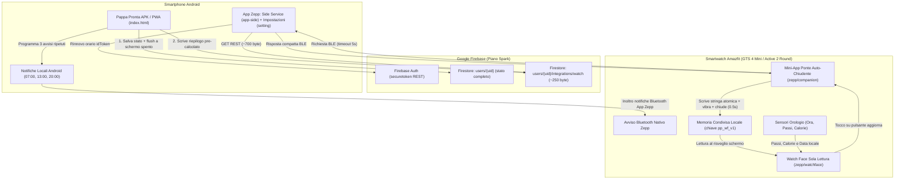

# Watch Face Amazfit (Active 2 Round & GTS 4 Mini) per Pappa Pronta

*   **Author:** Leo Amadori
*   **Status:** Approved
*   **Date:** 2026-11-19

--------------------------------------------------------------------------------

## Overview

**Pappa Pronta** è un'applicazione web progressiva (**PWA**, utilizzabile da browser) e applicazione nativa Android (**APK**, pacchetto installabile su smartphone Android) dedicata all'organizzazione dei pasti, al monitoraggio dei **12 Cibi Sani** giornalieri (protocollo *Daily Dozen*: 12 categorie di alimenti vegetali e abitudini quotidiane per un totale di `24` porzioni al giorno), al controllo dell'attività motoria e al **digiuno intermittente** (alternanza programmata tra ore di digiuno e finestra oraria dei pasti, come `16:8`, `14:10` o `12:12`).

Questo progetto estende Pappa Pronta al polso tramite un quadrante orologio (**Watch Face**) di sola lettura e una piccola applicazione ponte (**Mini-App companion**) per il sistema operativo **Zepp OS** degli smartwatch Amazfit, coprendo i due modelli usati in alternanza dallo stesso utente:
*   **Amazfit Active 2 Round** (cassa rotonda da `466x466` pixel con schermo AMOLED, basato su Zepp OS 4.2/5.0) come orologio principale, attualmente in assistenza tecnica.
*   **Amazfit GTS 4 Mini** (cassa rettangolare da `336x384` pixel, basato su Zepp OS 1.0) come orologio di riserva, indossato attualmente e ogni volta che l'orologio principale è scarico.

L'intero inserimento dei pasti resta sullo smartphone dentro Pappa Pronta, sostenuto da tre notifiche giornaliere (`07:00`, `13:00`, `20:00`) generate dal telefono e inoltrate via Bluetooth all'orologio indossato.

## The Problem

Oggi l'utente dispone già in Pappa Pronta degli strumenti per calcolare il digiuno intermittente, le porzioni dei 12 Cibi Sani e la soglia di movimento giornaliero, ma nella pratica quotidiana **non sta tracciando nulla durante la giornata** per tre ostacoli concreti:

1.  **Assenza di riscontro immediato a colpo d'occhio**: controllare a che punto è la finestra di digiuno o quante porzioni di cibi sani mancano a fine giornata richiede ogni volta di prendere lo smartphone, sbloccarlo e aprire l'applicazione. Lontano dal telefono, gli obiettivi giornalieri escono dall'attenzione fino a sera, quando è ormai tardi per riequilibrare i pasti o il movimento.
2.  **Mancanza di inneschi orari regolari**: senza un promemoria nei tre snodi chiave della giornata (mattina alle `07:00`, pranzo alle `13:00`, cena/chiusura finestra alimentare alle `20:00`), l'utente dimentica di registrare i pasti sul telefono, lasciando vuoti i contatori.
3.  **Inadeguatezza dello schermo dell'orologio per l'inserimento dati e discontinuità tra due orologi**: inserire alimenti o orari su uno schermo da polso è scomodo e indesiderato dall'utente; d'altra parte, poiché l'utente alterna due orologi con sistemi operativi di generazioni diverse (Active 2 Round e GTS 4 Mini), qualsiasi contatore mantenuto solo nella memoria interna di un singolo orologio perderebbe i progressi della giornata ad ogni cambio di dispositivo.

La soluzione proposta separa nettamente **inserimento** e **consultazione**: lo smartphone resta l'unico punto di registrazione (stimolato da tre avvisi giornalieri che arrivano anche al polso), mentre il quadrante dello smartwatch mostra in meno di due secondi lo stato del digiuno, i passi e le calorie bruciate misurati dai sensori al polso, e il punteggio `X/24` dei cibi sani sincronizzato dal telefono con un singolo tocco di aggiornamento.

## Goals

*   **Consultazione immediata in meno di 2 secondi**: mostrare sul quadrante di **Amazfit GTS 4 Mini** (`336x384` px) e **Amazfit Active 2 Round** (`466x466` px) ora, data, stato e avanzamento orario del digiuno intermittente, passi + calorie bruciate + indicatore di raggiungimento dell'obiettivo motorio, punteggio giornaliero dei cibi sani (`X/24`) ed età dell'ultima sincronizzazione.
*   **Zero inserimento dati sull'orologio**: nessuna digitazione, selezione di categorie alimentari o modifica di orari dei pasti avviene sullo smartwatch; l'unica interazione ammessa sul polso è un singolo tocco sull'icona di aggiornamento (`↻`) per scaricare i dati aggiornati dal telefono e tornare automaticamente al quadrante (`<= 3–5 secondi` in condizioni nominali, timeout `8,5 secondi`).
*   **Continuità nel cambio orologio e a cavallo della mezzanotte**: passando da Active 2 Round a GTS 4 Mini (o viceversa) a metà giornata, il nuovo orologio recupera lo stato aggiornato della giornata dal Cloud di Pappa Pronta; allo scoccare della mezzanotte locale (`00:00`), il conteggio dei cibi sani del giorno precedente si azzera sul quadrante anche senza connessione telefonica, mentre il cronometro del digiuno continua ad avanzare in autonomia.
*   **Coerenza dell'obiettivo motorio senza falsi positivi**: mentre sull'app telefonica Pappa Pronta il movimento giornaliero scatta a `>= 7.500 passi` o `>= 300 kcal attive`, sul polso la soglia viene valutata su `>= 7.500 passi` (o su un allenamento già registrato in Pappa Pronta), impedendo che il **metabolismo basale** (**BMR**, le calorie consumate dal corpo a riposo anche dormendo, incluse nel contatore calorie dei firmware Amazfit) faccia risultare superata per errore la soglia delle `300 kcal` durante la notte.
*   **Tre promemoria giornalieri multi-orologio**: generare localmente sull'app Android di Pappa Pronta tre notifiche attivabili o disattivabili (`07:00`, `13:00`, `20:00`) che l'app Zepp inoltra via Bluetooth a qualunque dei due orologi sia al polso in quel momento.
*   **Consegna immediata sull'orologio oggi disponibile**: rendere subito operativo il sistema sul **GTS 4 Mini** attualmente al polso, mantenendo pronta e compatibile la configurazione grafica tonda per l'**Active 2 Round** al suo rientro dalla riparazione e preservando un consumo ridotto in modalità schermo sempre attivo (**Always-On Display / AOD**, con meno del `10%` di pixel accesi su sfondo nero).

## Non-Goals

*   **Registrazione pasti o dispensa dal polso**: non verranno creati pulsanti sull'orologio per aggiungere porzioni dei 12 Cibi Sani, avviare/chiudere manualmente la cena o consultare ricette e lista della spesa.
*   **Dettaglio delle singole 12 categorie sul quadrante**: il quadrante mostra esclusivamente il punteggio sintetico complessivo (`X/24`) e non la griglia esplosa delle 12 icone alimentari.
*   **Servizio di sincronizzazione Bluetooth continuo 24/7 in Fase 1**: non verrà attivato un processo sempre acceso in background sull'orologio che interroga il telefono ogni pochi minuti, per non penalizzare l'autonomia della batteria dell'Active 2 Round.
*   **Infrastruttura server aggiuntiva o piani Cloud a pagamento**: non verranno introdotte Cloud Functions, server intermedi o notifiche push remote; l'intera soluzione deve rientrare nelle quote gratuite attuali di Firebase Spark.
*   **Pubblicazione sullo store pubblico Zepp o supporto ad altri modelli**: l'installazione avverrà in modalità sviluppatore personale; restano fuori perimetro la variante quadrata di Active 2 (`390x450` px) e gli smartwatch non Zepp OS (Wear OS, Apple Watch, Garmin).

## Open Questions

*   **Verifica Hardware 1 (Visibilità di memoria tra Watch Face e Mini-App su GTS 4 Mini)**: confermare con un test preliminare di 10 righe sul GTS 4 Mini fisico che il firmware Zepp OS 1.0 consenta alla Watch Face di leggere la stringa scritta in memoria di sistema (`SysPro`) dalla Mini-App ponte; in caso di blocco firmware tra pacchetti con identificativo diverso, si attiverà il piano di ripiego già predisposto (visualizzazione del cruscotto direttamente nella Mini-App apribile con un tasto rapido).

## Critical User Journeys (CUJs)

### CUJ 1: Controllo passivo a colpo d'occhio sul polso

*   **Given**: l'utente indossa il GTS 4 Mini (o l'Active 2 Round), ha già collegato una sola volta il proprio account Pappa Pronta nelle impostazioni Zepp e ha sincronizzato il pasto precedente.
*   **When**: l'utente ruota il polso durante la mattina o il pomeriggio senza avere lo smartphone in mano.
*   **Then**: in meno di 2 secondi legge sul quadrante l'ora, la fase attuale del digiuno con le ore trascorse/rimanenti calcolate in tempo reale dall'orologio, i passi e le calorie attuali con l'indicatore dell'obiettivo `7.500 passi`, il totale `X/24` dei cibi sani e l'orario dell'ultima sincronizzazione.

### CUJ 2: Promemoria delle 13:00 / 20:00, registrazione pasto sul telefono e aggiornamento a 1 tocco

*   **Given**: sull'app Android di Pappa Pronta sono attivi i tre avvisi giornalieri (`07:00`, `13:00`, `20:00`) e l'inoltro notifiche Zepp è abilitato.
*   **When**: alle `13:00` (o alle `20:00`) l'orologio vibra mostrando il promemoria; l'utente apre Pappa Pronta sullo smartphone, registra il pasto con i relativi cibi sani e tocca l'icona `↻` sul quadrante dell'orologio.
*   **Then**: Pappa Pronta salva immediatamente i dati sul Cloud anche se lo schermo del telefono viene bloccato subito; la Mini-App ponte sull'orologio scarica il nuovo riepilogo in `1–2 secondi`, emette una breve vibrazione di conferma e si richiude da sola riportando l'utente sul quadrante aggiornato con la nuova finestra di digiuno e il nuovo punteggio `X/24`.

### CUJ 3: Cambio di orologio a metà giornata per batteria scarica o rientro dalla riparazione

*   **Given**: l'utente ha accumulato `14/24` porzioni di cibi sani e una finestra alimentare aperta registrando i pasti sul telefono mentre indossava un orologio, che a metà pomeriggio si scarica; l'utente indossa l'altro modello (es. passa da Active 2 Round a GTS 4 Mini).
*   **When**: il secondo orologio si accende (mostrando inizialmente lo stato non sincronizzato `--/24` invece di zeri ingannevoli) e l'utente tocca l'icona `↻` sul quadrante.
*   **Then**: senza dover reinserire credenziali nell'app Zepp, il secondo orologio recupera dallo smartphone lo stesso punteggio `14/24`, la stessa finestra di digiuno e allinea il conteggio motorio giornaliero.

### CUJ 4: Passaggio automatico della mezzanotte a telefono spento o disconnesso

*   **Given**: alle `23:30` il quadrante segna `18/24` cibi sani e digiuno iniziato alle `20:00`, e durante la notte il Bluetooth del telefono è spento.
*   **When**: l'utente si sveglia alle `07:00` e guarda il quadrante prima ancora di riattivare il collegamento con il telefono.
*   **Then**: il quadrante riconosce il cambio di data locale, azzera subito a `0/24` le porzioni alimentari del nuovo giorno (evitando di mostrare il `18/24` del giorno precedente) e mostra correttamente `11h 00m` di digiuno trascorso calcolandolo dall'orario dell'ultimo pasto di ieri sera.

--------------------------------------------------------------------------------

## Technical Plan (Architecture)

### Panoramica dei Componenti e Flusso Dati

L'architettura collega l'ecosistema esistente di **Pappa Pronta** (PWA / APK Android + Cloud Firestore, descritti in [README.md](../../README.md)) agli smartwatch **Amazfit GTS 4 Mini** e **Amazfit Active 2 Round** attraverso cinque blocchi con responsabilità separate, senza aggiungere server intermedi e mantenendo tutto il calcolo delle regole nutrizionali in un solo posto (lo smartphone).

### 1. Sottodocumento Cloud Dedicato (`users/{uid}/integrations/watch`) e Sicurezza

Per evitare sia di scaricare nell'app Zepp l'intero documento storico `users/{uid}` (fino a `1–2 MB` di diari e codici a barre), sia di perdere i dati dell'orologio se una vecchia scheda browser sovrascrive `users/{uid}` tramite `setDoc` senza unione, Pappa Pronta scrive ad ogni sincronizzazione Cloud un sottodocumento dedicato:

*   **Percorso Firestore**: `users/{uid}/integrations/watch`
*   **Regole di accesso (`firestore.rules`)**: lettura e scrittura consentite esclusivamente al proprietario autenticato (`request.auth != null && request.auth.uid == userId`), con validazione stretta della lista di chiavi ammesse e dei limiti numerici (nessuna apertura pubblica del database e nessun elenco collezioni).
*   **Schema dati pre-calcolato** (tutti i riferimenti temporali sono espressi in **secondi epoch interi**, mai in millisecondi, per evitare overflow sui tipi interi firmati a 32 bit di Zepp OS 1.0):

| Campo | Tipo | Vincolo | Significato |
| :--- | :--- | :--- | :--- |
| `v` | `int` | `== 1` | Versione del contratto dati per compatibilità futura |
| `dateYmd` | `int` | `20200101..20991231` | Data locale del conteggio cibi nel formato intero `YYYYMMDD` |
| `fastMode` | `string` | `'fasting' \| 'eating' \| 'done' \| 'off'` | Stato risolto del digiuno calcolato da `computeFastingState()` |
| `protoFastH` | `int` | `0..24` | Ore previste di digiuno del protocollo attivo (`16`, `14`, `12` o `0`) |
| `protoEatH` | `int` | `0..24` | Ore previste di finestra alimentare (`8`, `10`, `12` o `0`) |
| `anchorSec` | `int` | `0..2147483647` | Timestamp in secondi di inizio della finestra o del digiuno in corso (`0` se assente) |
| `targetSec` | `int` | `0..2147483647` | Timestamp in secondi di chiusura finestra o raggiungimento obiettivo digiuno (`0` se assente) |
| `lastMealSec` | `int` | `0..2147483647` | Timestamp in secondi dell'ultimo pasto registrato per la transizione autonoma notturna `eating → fasting` |
| `foodDozen` | `int` | `0..23` | Somma delle 11 categorie alimentari/bevande Daily Dozen, **esclusa** la categoria `exercise` |
| `exerciseLogged` | `int` | `0 \| 1` | `1` se in `dateYmd` il movimento risulta già spuntato su Pappa Pronta / Health Connect, altrimenti `0` |
| `cloudSteps` | `int` | `0..200000` | Passi registrati in `logs[today].health.steps` per allineare il cambio orologio a metà giornata |
| `updatedAtSec` | `int` | `0..2147483647` | Timestamp in secondi dell'ultimo aggiornamento lato telefono |

*   **Scarico immediato alla chiusura schermo**: in `index.html` il timer di invio Cloud (`fbPushTimer`, oggi ritardato di `1,8 secondi`) viene eseguito immediatamente sull'evento `visibilitychange` quando `document.hidden` diventa `true`, così se l'utente registra il pranzo, blocca subito il telefono e tocca `↻` sull'orologio, il dato su Firestore è già aggiornato.

### 2. Accoppiamento Account Una Tantum e Servizio Ponte nell'App Zepp (`zepp/companion`)

La pagina di configurazione delle Mini-App dentro l'app Zepp gira in una vista web isolata che non può aprire il login Google OAuth (`403 disallowed_useragent`) né leggere la memoria interna dell'APK di Pappa Pronta:

*   **Esportazione credenziali da Pappa Pronta**: nella finestra Cloud di `index.html` viene aggiunto un pulsante **"Collega Orologio Zepp"** (visibile solo a utente autenticato) che copia negli appunti una stringa JSON di accoppiamento contenente `{ uid, refreshToken }` del profilo Firebase corrente (funzionante allo stesso modo sia per accessi con Google sia con Email/Password).
*   **Salvataggio e rinnovo automatico nell'app Zepp**: l'utente incolla una sola volta la stringa nella pagina impostazioni (`setting/index.js`) della Mini-App dentro l'app Zepp. Le credenziali restano in `settingsStorage` sullo smartphone (mai nel codice sorgente) e sopravvivono automaticamente al passaggio tra GTS 4 Mini e Active 2 Round perché entrambi puntano allo stesso `appId` della Mini-App companion.
*   **Scambio token e lettura leggera (`app-side/index.js`)**: quando l'orologio chiede un aggiornamento via Bluetooth, il servizio `app-side` verifica se ha in memoria un `idToken` valido (con margine di sicurezza di 5 minuti prima della scadenza di 60 minuti); se scaduto, lo rinnova chiamando `POST https://securetoken.googleapis.com/v1/token?key={apiKey}`, poi esegue `GET https://firestore.googleapis.com/v1/projects/pappa-pronta-leo/databases/(default)/documents/users/{uid}/integrations/watch` (~700 byte) e restituisce i valori compatti all'orologio insieme a un codice di esito (`0=OK`, `1=NO_BLE`, `2=AUTH_EXPIRED`, `3=HTTP_ERR`, `4=NOT_FOUND`).

### 3. Sincronizzazione Auto-Chiudente a 1 Tocco e Passaggio Dati alla Watch Face

Per garantire compatibilità immediata con il **GTS 4 Mini** (Zepp OS 1.0, privo di servizi in background) e zero spreco di batteria sull'**Active 2 Round** (Zepp OS 4.2), entrambi gli orologi condividono in Fase 1 lo stesso meccanismo di aggiornamento su richiesta:

1.  **Area di tocco dedicata sul quadrante**: sulla Watch Face solo un pulsante circoscritto con icona `↻` (dimensione minima `64x64` pixel accanto al punteggio `X/24` e all'orario dell'ultima sincronizzazione) avvia `hmApp.startApp` verso la Mini-App ponte; toccare il resto dello schermo per svegliare l'orologio non apre alcuna applicazione.
2.  **Scrittura atomica e chiusura automatica**: appena aperta, la Mini-App mostra `"Sincronizzazione..."`, interroga `app-side` via Bluetooth con timeout massimo di `5 secondi`, serializza l'intero stato ricevuto in **una sola stringa compatta delimitata** salvata tramite `hmFS.SysProSetChars('pp_wf_v1', payloadString)` (evitando letture incoerenti tra più chiavi separate), emette una breve vibrazione e richiama `hmApp.goBack()` entro `500 ms` riportando da sola l'utente sulla Watch Face aggiornata. Se la rete o il Bluetooth falliscono, non chiude la schermata ma mostra la causa precisa in italiano (es. `"Telefono non connesso"` o `"Ricollega account in Zepp"`).
3.  **Verifica preliminare sul GTS 4 Mini e piano di ripiego**: il primo passo implementativo consiste in una prova di 10 righe sul GTS 4 Mini fisico per confermare che `SysProGetChars('pp_wf_v1')` scritto dalla Mini-App sia visibile dalla Watch Face. Se il firmware isolasse quella memoria per singolo `appId`, la Mini-App stessa mostrerà direttamente l'intero cruscotto grafico (ora, digiuno, passi/calorie, `X/24`) richiamabile con un singolo tasto rapido sul GTS 4 Mini, mantenendo la Watch Face completa sull'Active 2 Round.

### 4. Logica di Visualizzazione Locale e Layout della Watch Face (`zepp/watchface`)

Ad ogni accensione dello schermo (`onResume` del delegato widget), la Watch Face calcola tutto localmente in pochi millisecondi senza interrogare la rete:

*   **Adattamento ai due schermi e AOD**: un modulo di calcolo condiviso alimenta due mappe di coordinate distinte nel file `app.json` multi-target:
    *   `gts4mini` (`336x384` px rettangolare, `configVersion: v2` / API Level `1.0`): fascia superiore con ora grande, data e stato batteria/Bluetooth; fascia centrale con barra/stato digiuno e ore trascorse/rimanenti; fascia inferiore divisa tra box Movimento (passi + calorie + spunta obiettivo) e box Cibi Sani (`X/24` + pulsante `↻ HH:MM`).
    *   `active2round` (`466x466` px rotondo): disposizione radiale entro il cerchio di sicurezza interno per evitare tagli sui bordi curvi, con arco superiore per il digiuno, ora centrale e due quadranti inferiori per Movimento e Cibi Sani (`X/24` + `↻`).
    *   **Always-On Display (AOD)**: sfondo nero puro (`#000000`) con meno del `10%` di pixel illuminati, limitato a orario digitale e indicatore sintetico della fase di digiuno (nascondendo contatori non aggiornati per evitare sia consumi anomali sia *burn-in* dei pixel AMOLED).
*   **Gestione mezzanotte, riavvio e calcolo autonomo del digiuno**:
    *   Se `pp_wf_v1` è vuota (primo avvio o riavvio dell'orologio che svuota la RAM `SysPro`), il quadrante mostra `--/24` e `"Tocca ↻"` anziché mostrare `0/24` o orari predefiniti fuorvianti.
    *   Se la data hardware dell'orologio (`oggiYmd`) è successiva a `dateYmd` salvato in `pp_wf_v1`, la Watch Face forza immediatamente `foodDozen = 0`, `exerciseLogged = 0` e `cloudSteps = 0` senza attendere il telefono.
    *   Il digiuno scorre invece in modo continuo da `anchorSec` e `targetSec`: se durante un digiuno `nowSec >= targetSec`, il quadrante commuta da solo lo stato visivo in **"Obiettivo raggiunto"** mostrando il totale delle ore digiunate.
*   **Regola anti-falso-positivo BMR e anti-doppio-conteggio `X/24`**:
    *   L'orologio legge `passiSensore` (`STEP`) e `calorieSensore` (`CALORIE`). Per coprire il caso di cambio orologio a metà pomeriggio, usa `passiEffettivi = max(passiSensore, dateYmd == oggiYmd ? cloudSteps : 0)`.
    *   L'obiettivo motorio giornaliero risulta raggiunto sul polso se e solo se `passiEffettivi >= 7500` **oppure** `exerciseLogged == 1` (escludendo dal confronto diretto con `300` il contatore calorie locale dell'orologio perché include il metabolismo basale notturno).
    *   Il punteggio cibi sani mostrato sul quadrante è calcolato in modo idempotente come `cibiMostrati = foodDozen + (obiettivoMotorioRaggiunto ? 1 : 0)` su `24`, così superare i `7.500 passi` aggiorna subito `X/24` al polso senza mai sommare due volte il punto movimento dopo una sincronizzazione Cloud.

### 5. Tre Notifiche Giornaliere (`07:00`, `13:00`, `20:00`) e Isolamento Repository / CI

*   **Notifiche locali Android senza server**: nella pipeline `.github/workflows/build-apk.yml` viene aggiunto il plugin `@capacitor/local-notifications` insieme ai permessi Android `POST_NOTIFICATIONS` e `RECEIVE_BOOT_COMPLETED` (usando avvisi giornalieri ripetuti `on: { hour, minute }` con `allowWhileIdle: true` su canale ad alta importanza `IMPORTANCE_HIGH`, evitando il permesso speciale bloccante `SCHEDULE_EXACT_ALARM` su Android 14+).
*   **ID fissi, interruttore e diagnostica**: `index.html` programma in modo idempotente tre ID costanti (`700`, `1300`, `2000`), aggiornando il testo dei promemoria residui della giornata ogni volta che l'utente registra un pasto, ed espone nel Profilo un interruttore ON/OFF, un pulsante **"Invia notifica di prova tra 5 secondi"** (per testare l'inoltro Bluetooth a schermo spento) e il promemoria in 3 passi per abilitare *Pappa Pronta* negli *Avvisi App* di Zepp su entrambi gli orologi.
*   **Isolamento dei file Zepp da Hosting e rebuild APK**: tutto il codice Zepp vive sotto `zepp/` (`zepp/shared/`, `zepp/companion/`, `zepp/watchface/`), senza aggiungere `package.json` nella radice del repository. `firebase.json` (`hosting.ignore`) e `.gitignore` vengono aggiornati per escludere `zepp/**`, `*.zab` e `*.zpk` dal sito web pubblico, mentre `build-apk.yml` ignora le modifiche confinate a `zepp/**` (`paths-ignore`) così lo sviluppo dei quadranti non innesca inutili compilazioni dell'APK Android; un workflow separato compila i pacchetti `.zab` in modalità non interattiva tramite `@zeppos/zeus-cli` (`zeus build`).

--------------------------------------------------------------------------------

## Alternatives Considered

### Alternative A: Watch Face autonoma con inserimento pasti direttamente sull'orologio

*   **Pros**: nessuna dipendenza da Cloud Firestore, dall'app Zepp sul telefono o dal collegamento Bluetooth; funzionamento immediato senza Mini-App ponte.
*   **Cons**: costringe l'utente a toccare ripetutamente uno schermo minuscolo per segnare cibi e orari; inoltre i dati restano chiusi nella memoria interna di un singolo orologio e si perdono passando dall'Active 2 Round al GTS 4 Mini quando la batteria si scarica o l'orologio va in assistenza.
*   **Reason for Rejection**: contraddice il requisito primario dell'utente (*zero inserimento dati sull'orologio*) e rompe la continuità giornaliera nell'uso alternato dei due smartwatch.

### Alternative B: Sola Mini-App Cruscotto abbinata a un quadrante Amazfit di fabbrica (senza Watch Face dedicata)

*   **Pros**: dimezza i pacchetti da sviluppare (una sola Mini-App invece di Watch Face + Mini-App) ed elimina il passaggio dati tramite memoria di sistema `SysPro`.
*   **Cons**: ruotando il polso si vedono solo ora, passi e calorie del quadrante standard, mentre per leggere la finestra di digiuno e il punteggio `X/24` dei cibi sani occorre premere un pulsante fisico o scorrere le schede ogni volta.
*   **Reason for Rejection**: non soddisfa l'obiettivo di consultazione passiva immediata sul quadrante principale; resta tuttavia mantenuta come piano di ripiego per il solo GTS 4 Mini qualora il test preliminare di 10 righe rivelasse un blocco firmware sulla lettura `SysPro` tra pacchetti diversi.

### Alternative C: Servizio in background continuo (`app-service` Zepp OS 4.2) attivo 24/7 su Active 2 Round

*   **Pros**: aggiorna il punteggio `X/24` sulla Watch Face dell'Active 2 Round senza toccare l'icona `↻` dopo aver registrato un pasto sul telefono.
*   **Cons**: consuma dal `30%` al `50%` di batteria aggiuntiva per interrogare via Bluetooth uno stato che cambia solo `2–4` volte al giorno; richiede un ramo di codice separato incompatibile con Zepp OS 1.0 (GTS 4 Mini) e non è verificabile oggi su hardware reale perché l'Active 2 Round è in riparazione.
*   **Reason for Rejection**: ridurre l'autonomia dell'Active 2 Round aggraverebbe proprio la causa che costringe l'utente a ripiegare sul GTS 4 Mini; la sincronizzazione a 1 tocco auto-chiudente copre entrambi i modelli con consumo nullo a riposo.

### Alternative D: Campo `watchSummary` dentro il documento principale `users/{uid}` invece del sottodocumento dedicato

*   **Pros**: richiede una sola scrittura Firestore invece di due ad ogni salvataggio sul telefono, leggendo poi solo `?mask.fieldPaths=watchSummary`.
*   **Cons**: in `index.html` la funzione `pushCloudState()` salva `users/{uid}` tramite `setDoc` senza `{ merge: true }`; qualunque vecchia scheda browser o vecchio APK non aggiornato rimasto aperto sovrascriverebbe l'intero documento cancellando `watchSummary`.
*   **Reason for Rejection**: scartata a favore del sottodocumento isolato `users/{uid}/integrations/watch`, che è immune alle sovrascritture del documento principale da parte di client meno recenti.

### Alternative E: Nessuna modifica allo schema Cloud e ricalcolo da `logs` di ieri/oggi dentro il servizio Zepp

*   **Pros**: non richiede alcuna modifica a `firestore.rules` né scritture aggiuntive da parte di `index.html`.
*   **Cons**: costringe a duplicare e mantenere allineate in due progetti separati (`index.html` e `zepp/companion`) le 140 righe di logica di accorpamento pasti di `computeFastingState()` e il calcolo delle 12 categorie di `computeDozenTotal()`, oltre a richiedere maschere REST con codifica speciale per le chiavi data con trattino.
*   **Reason for Rejection**: introduce un rischio elevato di divergenza futura tra gli orari di digiuno mostrati sullo smartphone e quelli mostrati al polso.

### Alternative F: Scaricamento dell'intero documento `users/{uid}` o invio notifiche tramite server Cloud Functions / Push

*   **Pros**: evita di filtrare i campi lato lettura o consente notifiche calcolate da remoto a telefono chiuso.
*   **Cons**: scaricare `users/{uid}` intero trasferisce fino a `1–2 MB` per lettura (rischio superamento del limite mensile gratuito di `10 GiB` di Firebase Spark e saturazione memoria nell'app Zepp); le notifiche push remote richiedono Cloud Scheduler e Cloud Functions con piano a pagamento Blaze.
*   **Reason for Rejection**: sproporzionato nei costi e nelle risorse rispetto a un sottodocumento di `250 byte` e a tre sveglie locali Android tramite `@capacitor/local-notifications`.

--------------------------------------------------------------------------------

## Non-Functional Requirements

*   **Sicurezza e Privacy**:
    *   Il sottodocumento `users/{uid}/integrations/watch` non contiene dati anagrafici, email o testo libero dei pasti, ma solo contatori numerici e timestamp, protetti da `request.auth.uid == userId` in `firestore.rules`.
    *   Il `refreshToken` Firebase viene salvato esclusivamente in `settingsStorage` locale dell'app Zepp sullo smartphone dell'utente e non transita mai verso l'orologio via Bluetooth né viene mai salvato nel repository Git.
*   **Quote Cloud, Rete e Batteria**:
    *   **Traffico Firestore**: `~700 byte` per sincronizzazione (`< 15 KB/giorno` e `< 0,5 MB/mese` con 10–20 aggiornamenti giornalieri, pari a meno dello `0,01%` della soglia gratuita Firebase Spark di `10 GiB/mese` e `50.000 letture/giorno`).
    *   **Consumo energetico orologio**: zero timer o connessioni Bluetooth attive in background sull'orologio; ricalcolo locale in `< 5 ms` al solo risveglio dello schermo e modalità AOD sotto il `10%` di pixel accesi.
*   **Rilascio e Ripristino (Rollout & Rollback)**:
    *   **Ordine di rilascio obbligatorio**: pubblicare `firestore.rules` *prima* di aggiornare `index.html` e l'APK Android, così la scrittura su `users/{uid}/integrations/watch` non viene mai rifiutata con `PERMISSION_DENIED`. Tuttavia, un eventuale errore sulla scrittura del sottodocumento `watch` viene intercettato separatamente senza mai bloccare il salvataggio principale di `users/{uid}`.
    *   **Rollback**: riportare `index.html` o `build-apk.yml` alla versione precedente non altera `users/{uid}` e lascia funzionante l'app principale; la funzione di cancellazione Cloud GDPR (`deleteCloudUserData`) elimina anche `users/{uid}/integrations/watch` e i pacchetti Zepp si disinstallano dall'app Zepp in qualsiasi momento.

## Risks & Mitigations

*   **Installazione pacchetti `.zab` (*Zepp App Bundle*) in Modalità Sviluppatore Zepp**: l'app smartphone ufficiale Zepp non offre un selettore file diretto per i `.zab`, ma installa tramite codice QR (`zeus preview` in locale oppure caricamento del `.zab` come bozza personale non pubblicata su `console.zepp.com`) o tramite `zeus bridge` su rete Wi-Fi locale. Entrambe le procedure sono documentate in `README.md`.
*   **Compatibilità BLE Zepp OS 1.0 e callback `WIDGET_DELEGATE`**: poiché `@zeppos/zml` richiede API 3.0+, il trasporto BLE usa il modulo `MessageBuilder` compatibile API 1.0 (`hmBle` + `messaging.peerSocket` con timeout `8,5 s`), mentre la Watch Face registra `resume_call`/`pause_call` su `WIDGET_DELEGATE` e `MINUTEEND` sul sensore `TIME` per aggiornare anche l'AOD ogni minuto.
*   **Portata del `refreshToken` e restrizioni `apiKey`**: il `refreshToken` copiato in `settingsStorage` possiede privilegi completi di proprietario e resta valido dopo `signOut` sul telefono (la UI avvisa di svuotare gli appunti e scollegare Zepp in caso di disconnessione); la `apiKey` Firebase non deve avere restrizioni HTTP Referrer browser su Google Cloud perché `app-side` effettua chiamate `fetch` senza header `Referer`.
*   **Tolleranza Doze Android sulle notifiche ripetute**: in assenza di `SCHEDULE_EXACT_ALARM`, Android 12–15 può posticipare gli avvisi di `±15–30 minuti` in modalità Doze, e in Fase 1 i tre testi restano statici e indipendenti dalla data per non riproporre contatori del giorno precedente quando l'app non viene aperta.

--------------------------------------------------------------------------------

### Future Improvements

Le seguenti evoluzioni sono mantenute fuori dalle Fasi 0–3 del piano esecutivo per non rallentare il rilascio iniziale sul GTS 4 Mini e non introdurre codice non testabile mentre l'Active 2 Round è in assistenza, ma sono già compatibili con l'architettura scelta:

1.  **Sincronizzazione passiva diurna a bassa frequenza su Active 2 Round (`07:00–22:00`)**:
    *   **Meccanismo**: aggiungere sul solo target `active2round` (`configVersion: "v3"`) un servizio leggero `@zos/app-service` che interroga il telefono una volta ogni `60 minuti` solo nella fascia `07:00–22:00` (zero risvegli notturni tra le `22:00` e le `07:00`), affiancando il pulsante `↻`.
    *   **Utilità e limiti**: mantiene allineato il quadrante anche se dopo un pasto si dimentica di toccare `↻`; richiede il rientro fisico dell'Active 2 Round dalla riparazione per misurare il consumo reale sulla batteria ed è incompatibile con Zepp OS 1.0 del GTS 4 Mini.
2.  **Orari notifiche personalizzabili e suggerimento serale dei cibi mancanti o in scadenza**:
    *   **Meccanismo**: sostituire nel Profilo di `index.html` i tre orari fissi (`07:00`, `13:00`, `20:00`) con selettori orari configurabili salvati in `pappa_pronta_watch_reminders_v1`, e includere nel testo dell'avviso serale le 2–3 categorie dei 12 Cibi Sani ancora a zero nella giornata (es. *Semi di lino*, *Frutti di bosco*, *Crucifere*) insieme a un eventuale ingrediente segnato in scadenza (`⏳`) in dispensa.
    *   **Utilità e limiti**: porta sul display dell'orologio via notifica Bluetooth un consiglio pratico per completare la cena senza aggiungere codice grafico sulla Watch Face; il testo contestuale serale riflette l'ultimo stato calcolato quando l'app è stata aperta sul telefono durante la giornata.
3.  **Indicatore cromatico delle 5 Fasi Metaboliche del Digiuno sul quadrante**:
    *   **Meccanismo**: colorare progressivamente la barra o l'arco del digiuno sulla Watch Face seguendo le 5 soglie già presenti in `index.html` (`0–4h` Digestione, `4–8h` Calma Insulina, `8–12h` Cambio Carburante, `12–16h` Brucia-Grassi, `16h+` Pulizia Cellulare), calcolate interamente in locale da `nowSec - anchorSec`.
    *   **Utilità e limiti**: offre continuità visiva immediata con il timer di Pappa Pronta a costo energetico e di rete nullo; richiede una verifica di leggibilità e contrasto sullo schermo `336x384` px del GTS 4 Mini restando disattivato in modalità AOD.
4.  **Allineamento bidirezionale dei passi (`watchSteps` → `cloudSteps`) al tocco di `↻`**:
    *   **Meccanismo**: allegare alla richiesta BLE del pulsante `↻` il numero di passi letti dal sensore dell'orologio indossato, così il servizio `app-side` aggiorna `cloudSteps = max(cloudSteps, watchSteps)` su `users/{uid}/integrations/watch` tramite chiamata `PATCH` REST.
    *   **Utilità e limiti**: preserva il totale passi della mattina quando si cambia orologio a metà giornata anche senza aver prima aperto Pappa Pronta per sincronizzare Health Connect; richiede attenzione al cambio data intorno alla mezzanotte per non riportare i passi di ieri sul giorno nuovo.
5.  **Scheda Rapida laterale (*Shortcut Card*) su Active 2 Round**:
    *   **Meccanismo**: affiancare alla Watch Face sintetica una scheda secondaria scorrevole su Zepp OS 4.2 che mostra l'elenco compatto delle categorie Daily Dozen mancanti, la modalità `⚡ Giorno Attivo` / `🧘 Giorno Leggero` e l'orario esatto di fine finestra pasti.
    *   **Utilità e limiti**: mantiene sgombro il quadrante principale rendendo disponibile il dettaglio con un solo scorrimento laterale; supportata solo su Active 2 Round (assente su Zepp OS 1.0 del GTS 4 Mini).
6.  **Pre-avviso dinamico di chiusura finestra alimentare (`-30 minuti` da `targetSec`)**:
    *   **Meccanismo**: all'apertura della finestra pasti in `index.html`, programmare automaticamente una notifica locale singola `30 minuti` prima di `targetSec` (annullata subito se l'utente preme prima *"Ho finito di cenare"*).
    *   **Utilità e limiti**: previene lo sforamento involontario della finestra `16:8` o `14:10` nei giorni in cui il primo pasto slitta; deve avere un interruttore indipendente per evitare eccesso di notifiche al polso.

--------------------------------------------------------------------------------

## Detailed Implementation Plan

### Fasi di Esecuzione e Punti di Controllo (Phasing & Checkpoints)

1.  **Fase 0 — Verifica Hardware Preliminare su GTS 4 Mini (`SysPro` Cross-App)**: compilare pacchetti minimi per `zepp/companion` (`appId: 1058201`) e `zepp/watchface` (`appId: 1058202`) e verificare sul GTS 4 Mini fisico che una stringa scritta con `hmFS.SysProSetChars('pp_wf_v1', ...)` dalla Mini-App venga letta tramite `hmFS.SysProGetChars('pp_wf_v1')` dalla Watch Face; rilevare contemporaneamente il valore restituito a riposo da `hmSensor.id.CALORIE`. Se la lettura tra pacchetti funziona, mantenere attivo il flusso standard (`DASHBOARD_FALLBACK_MODE = false`); se il firmware isola la memoria per `appId`, impostare `DASHBOARD_FALLBACK_MODE = true` sul target `gts4mini` per mostrare il cruscotto direttamente nella Mini-App.
2.  **Fase 1 — Isolamento Repository, Regole Cloud e Aggiornamento Pappa Pronta + Notifiche Android**: aggiornare [`.gitignore`](../../.gitignore), [`firebase.json`](../../firebase.json) e [`firestore.rules`](../../firestore.rules) (pubblicando prima le regole Cloud), poi estendere [`index.html`](../../index.html) e [`build-apk.yml`](../../.github/workflows/build-apk.yml) con la scrittura del sottodocumento `users/{uid}/integrations/watch`, il pulsante di accoppiamento Zepp e le tre notifiche giornaliere (`07:00`, `13:00`, `20:00`).
3.  **Fase 2 — Contratto Condiviso Zepp, Test Unitari e Mini-App Ponte (`zepp/shared` + `zepp/companion`)**: implementare e verificare con test automatici il serializzatore e i calcoli puri di mezzanotte/digiuno/movimento, quindi completare impostazioni Zepp, rinnovo token `app-side` e schermata auto-chiudente sull'orologio.
4.  **Fase 3 — Watch Face Multi-Target (`336x384` e `466x466`), Pipeline CI Zepp e Documentazione**: completare i layout normali e AOD per GTS 4 Mini (testato sul dispositivo fisico) e Active 2 Round (verificato su simulatore Zepp OS), attivare `.github/workflows/build-zepp.yml` e aggiornare [`README.md`](../../README.md).

### Target Files to Create/Modify

#### 1. `.gitignore` (Modify — [`../../.gitignore`](../../.gitignore))

*   **Type / Scope**: Configurazione Git
*   **Proposed Changes**: aggiungere le esclusioni `zepp/**/node_modules/`, `zepp/**/dist/`, `*.zab` e `*.zpk`. Necessario per impedire che dipendenze locali o pacchetti binari compilati da `@zeppos/zeus-cli` finiscano nei commit del repository.

#### 2. `firebase.json` (Modify — [`../../firebase.json`](../../firebase.json))

*   **Type / Scope**: Configurazione Firebase Hosting
*   **Proposed Changes**: aggiungere `"zepp/**"`, `"*.zab"` e `"*.zpk"` all'array `hosting.ignore`. Necessario perché `"public": "."` pubblicherebbe altrimenti l'intero codice sorgente Zepp e gli artefatti binari sul dominio web pubblico `pappa-pronta-leo.web.app`.

#### 3. `firestore.rules` (Modify — [`../../firestore.rules`](../../firestore.rules))

*   **Type / Scope**: Regole di Sicurezza Cloud Firestore (modifica da delegare obbligatoriamente al subagent specialista `firestore-rules-author`)
*   **Proposed Changes**: aggiungere all'interno di `match /users/{userId}` una regola per il documento `match /integrations/watch` con `allow get, create, update, delete: if isOwner(userId)` (lasciando `list` negato) e funzione di validazione `isValidWatchSummary(data)` che accetta esclusivamente le 11 chiavi previste (`v`, `dateYmd`, `fastMode`, `protoFastH`, `protoEatH`, `anchorSec`, `targetSec`, `foodDozen`, `exerciseLogged`, `cloudSteps`, `updatedAtSec`) verificando i rispettivi tipi e intervalli numerici (`v == 1`, `dateYmd` in `20200101..20991231`, `fastMode` in `['fasting', 'eating', 'done', 'off']`, `protoFastH` e `protoEatH` in `0..24`, `foodDozen` in `0..23`, `exerciseLogged` in `0..1`, `cloudSteps` in `0..200000`, `anchorSec >= 0`, `targetSec >= 0`, `updatedAtSec >= 0`). Necessario per autorizzare il sottodocumento dell'orologio senza alterare le 14 chiavi bloccate del documento principale `users/{userId}`.

#### 4. `index.html` (Modify — [`../../index.html`](../../index.html))

*   **Type / Scope**: Applicazione Web / Mobile Single-File (Logica Stato, Cloud Sync, Accoppiamento Zepp e Notifiche Locali Capacitor)
*   **Proposed Changes**:
    *   **Costruzione riepilogo orologio (`buildWatchSummaryPayload`)**: aggiungere una funzione pura che riutilizza `computeFastingState()` e `computeDozenTotal()` per produrre l'oggetto a 11 campi con timestamp convertiti in secondi interi (`Math.floor(ms / 1000)`), calcolando `foodDozen` sulle sole 11 categorie alimentari/bevande (esclusa `exercise`), `exerciseLogged` (`1` se `logs[today].dozen.exercise >= 1` o soglia Health Connect attiva, altrimenti `0`) e `cloudSteps` da `logs[today].steps || 0`.
    *   **Scrittura Cloud isolata e scarico immediato**: in `pushCloudState()`, subito dopo il salvataggio di `users/{uid}`, scrivere `users/{uid}/integrations/watch` tramite `setDoc` dentro un blocco `try/catch` dedicato che registra eventuali codici errore in `state.syncHistory` senza interrompere il flusso principale; nel gestore `visibilitychange`, se `document.hidden === true` e `fbPushTimer` è attivo, annullare il timer da `1800 ms` ed eseguire immediatamente `pushCloudState(false)` per evitare dati non salvati quando si blocca lo schermo subito dopo aver registrato un pasto.
    *   **Pulsante di accoppiamento Zepp**: nella finestra modale Cloud aggiungere il pulsante **"Collega Orologio Zepp"** (attivo quando `fbCurrentUser` è presente) che copia negli appunti il JSON `{ projectId: 'pappa-pronta-leo', apiKey, uid, refreshToken }` estratto da `fbCurrentUser`, accompagnato dalla guida rapida in 3 punti per incollarlo nell'app Zepp e abilitare *Avvisi App → Pappa Pronta* su entrambi gli orologi.
    *   **Programmazione dei tre avvisi giornalieri (`07:00`, `13:00`, `20:00`)**: salvare la preferenza locale delle notifiche in una chiave `localStorage` dedicata (`pappa_pronta_watch_reminders_v1`, così da non aggiungere chiavi non previste a `state.profile` su Firestore). Quando `window.Capacitor?.isNativePlatform()` è vero, creare il canale Android `pappa_pronta_watch_reminders` (`importance: 5`, vibrazione attiva) e sincronizzare in modo idempotente tramite `Capacitor.Plugins.LocalNotifications` tre notifiche giornaliere ripetute con ID costanti `700` (`07:00`), `1300` (`13:00`) e `2000` (`20:00`) e `allowWhileIdle: true`, aggiornando il testo informativo al salvataggio dei pasti. Aggiungere nella sezione Profilo l'interruttore ON/OFF, lo stato del permesso `POST_NOTIFICATIONS` e il pulsante **"Invia notifica di prova tra 5 secondi"** (ID `7999`, con avviso di bloccare lo schermo dello smartphone durante i 5 secondi di attesa).

#### 5. `.github/workflows/build-apk.yml` (Modify — [`../../.github/workflows/build-apk.yml`](../../.github/workflows/build-apk.yml))

*   **Type / Scope**: Pipeline CI/CD GitHub Actions per APK Android
*   **Proposed Changes**:
    *   Aggiungere `paths-ignore: ['zepp/**', 'docs/**']` sotto `on.push` per evitare che le modifiche ai soli file dello smartwatch ricompilino e sovrascrivano la release dell'APK Android.
    *   Aggiungere `"@capacitor/local-notifications@^8.0.0"` al comando `npm install` e configurare l'icona/colore predefiniti del plugin `LocalNotifications` nel file `capacitor.config.json` generato.
    *   Aggiungere `"android.permission.POST_NOTIFICATIONS"` e `"android.permission.RECEIVE_BOOT_COMPLETED"` all'array `reqPerms` nello script di patch di `AndroidManifest.xml`, con relativa verifica `grep -q`. Necessario affinché Android 13–15 mostri e mantenga attivi i tre promemoria anche dopo il riavvio del telefono.

#### 6. `zepp/shared/contract.js` (Create)

*   **Type / Scope**: Libreria JavaScript pura condivisa tra Mini-App e Watch Face (compatibile ES5/ES6 senza dipendenze esterne)
*   **Proposed Changes**: definire le costanti condivise (`COMPANION_APP_ID = 1058201`, `WATCHFACE_APP_ID = 1058202`, `SYSPRO_KEY = 'pp_wf_v1'`, `STEP_GOAL = 7500`, codici di stato `0..4`), le funzioni di serializzazione e lettura della stringa singola delimitata da `|` (`1|status|dateYmd|fastMode|protoFastH|protoEatH|anchorSec|targetSec|foodDozen|exerciseLogged|cloudSteps|updatedAtSec|syncedAtSec`), la regola di azzeramento automatico al cambio data (`dateYmd < localTodayYmd`), il calcolo in tempo reale di ore/minuti e avanzamento percentuale del digiuno (inclusa la transizione automatica `fasting` → `done` quando `nowSec >= targetSec`), e il calcolo unificato dell'obiettivo motorio (`max(sensorSteps, cloudSteps) >= 7500 || exerciseLogged == 1`) e del punteggio `X/24` senza doppio conteggio. Necessario per avere un'unica fonte di verità matematica condivisa tra tutti i moduli Zepp.

#### 7. `zepp/shared/contract.test.mjs` (Create)

*   **Type / Scope**: Suite di Test Unitari (`node:test`)
*   **Proposed Changes**: coprire serializzazione/deserializzazione di `pp_wf_v1`, gestione di stringa vuota/corrotta dopo riavvio (`--/24`), azzeramento automatico di `foodDozen` e `exerciseLogged` a mezzanotte mantenendo attivo il timer del digiuno notturno, passaggio automatico a traguardo raggiunto, riallineamento passi dopo cambio orologio (`cloudSteps > sensorSteps`) e assenza di doppio conteggio sul `24°` punto quando sia l'orologio sia il Cloud segnano movimento completato. Necessario per validare offline tutti i casi limite prima dell'installazione sull'orologio.

#### 8. `zepp/companion/package.json` (Create)

*   **Type / Scope**: Configurazione Dipendenze Build Mini-App Zepp
*   **Proposed Changes**: dichiarare il pacchetto privato `pappa-pronta-zepp-companion` con dipendenza di sviluppo `@zeppos/zeus-cli` e libreria di comunicazione BLE `@zeppos/zml` compatibile con la pipeline di compilazione Zepp. Necessario per compilare il pacchetto `.zab` in locale e in CI.

#### 9. `zepp/companion/app.json` (Create)

*   **Type / Scope**: Manifesto Multi-Target Mini-App Zepp OS (`appId: 1058201`)
*   **Proposed Changes**: configurare `appType: "app"`, `configVersion: "v2"`, `runtime.apiVersion` compatibile `1.0.0`, permessi di rete/comunicazione e due target distinti sotto lo stesso `appId`: `gts4mini` (`deviceSource: [246, 247]`, `designWidth: 336`) e `active2round` (`deviceSource: [8913152, 10092800]`, `designWidth: 466`), collegando `page/index`, `app-side/index` e `setting/index`. Necessario per condividere un'unica configurazione account in `settingsStorage` sullo smartphone tra entrambi gli orologi.

#### 10. `zepp/companion/setting/index.js` (Create)

*   **Type / Scope**: Pagina Impostazioni dentro l'App Smartphone Zepp
*   **Proposed Changes**: fornire un campo testo per incollare il JSON di accoppiamento esportato da Pappa Pronta (`{ projectId, apiKey, uid, refreshToken }`), validarne i campi prima di salvarli in `settingsStorage`, mostrare un pulsante per scollegare l'account ed esporre un riquadro diagnostico di sola lettura con stato connessione, orario ultima lettura Cloud riuscita ed eventuale ultimo codice di errore HTTP/Auth. Necessario per completare l'autenticazione una tantum aggirando il blocco Google OAuth delle WebView.

#### 11. `zepp/companion/app-side/index.js` (Create)

*   **Type / Scope**: Servizio Telefonico Zepp (`Side Service`)
*   **Proposed Changes**: ascoltare le richieste di sincronizzazione provenienti dall'orologio via BLE, rinnovare al bisogno l'`idToken` Firebase tramite `POST https://securetoken.googleapis.com/v1/token?key={apiKey}` mantenendolo in cache fino a `scadenza - 300 secondi`, eseguire `GET https://firestore.googleapis.com/v1/projects/pappa-pronta-leo/databases/(default)/documents/users/{uid}/integrations/watch` con header `Authorization: Bearer {idToken}`, convertire la risposta REST tipizzata di Firestore nei campi numerici/stringa del contratto `contract.js`, registrare l'esito diagnostico in `settingsStorage` e inviare il pacchetto compatto all'orologio. Necessario perché i quadranti e le app da polso Zepp OS non possono eseguire chiamate HTTPS dirette verso Internet.

#### 12. `zepp/companion/page/index.js` e `zepp/companion/assets/` (Create)

*   **Type / Scope**: Interfaccia Orologio della Mini-App Ponte e Icone App
*   **Proposed Changes**: mostrare immediatamente `"Sincronizzazione..."` all'apertura, inviare la richiesta BLE a `app-side` con timeout rigido di `5000 ms`, salvare in caso di successo (`status == 0`) la stringa atomica tramite `hmFS.SysProSetChars('pp_wf_v1', serialized)`, attivare un impulso breve di vibrazione (`hmSensor.id.VIBRATE`) e chiudere automaticamente l'app tramite `hmApp.goBack()` dopo `500 ms` (oppure mostrare il cruscotto completo se la costante `DASHBOARD_FALLBACK_MODE` è attiva per limite firmware `SysPro`, o mostrare il messaggio d'errore italiano esplicito con pulsante `"Chiudi"` in caso di errore/timeout). Includere in `zepp/companion/assets/` le icone PNG richieste per `gts4mini` e `active2round`. Necessario per aggiornare i dati con un singolo tocco senza lasciare l'utente bloccato fuori dal quadrante.

#### 13. `zepp/watchface/package.json` e `zepp/watchface/app.json` (Create)

*   **Type / Scope**: Manifesto e Configurazione Build della Watch Face (`appId: 1058202`)
*   **Proposed Changes**: configurare `appType: "watchface"`, `configVersion: "v2"` (compatibilità API `1.0.0`), supporto `idle` / Always-On Display abilitato e target `gts4mini` (`336x384` px) e `active2round` (`466x466` px). Necessario per generare i pacchetti quadrante installabili su entrambi i modelli da un unico progetto.

#### 14. `zepp/watchface/watchface/layouts.js` (Create)

*   **Type / Scope**: Mappe Geometriche e Tipografiche Multi-Schermo
*   **Proposed Changes**: definire in modo dichiarativo coordinate, dimensioni caratteri (numeri principali `>= 24 px` su GTS 4 Mini e `>= 30 px` su Active 2 Round), colori ad alto contrasto su nero `#000000`, margini circolari di sicurezza per lo schermo tondo `466x466` px, area del pulsante `↻` (`>= 64x64 px`) e coordinate essenziali della modalità AOD (`< 10%` pixel accesi). Necessario per separare la geometria fisica dei due display dalla logica di lettura dati.

#### 15. `zepp/watchface/watchface/index.js` e `zepp/watchface/assets/` (Create)

*   **Type / Scope**: Motore di Rendering della Watch Face e Asset Grafici/Anteprime
*   **Proposed Changes**: istanziare i widget `hmUI` normali e AOD in base alla mappa di `layouts.js`, registrare `hmUI.widget.WIDGET_DELEGATE` per ricalcolare su `onInit` e `onResume` l'ora/data (`hmSensor.id.TIME`), i passi (`hmSensor.id.STEP`), le calorie (`hmSensor.id.CALORIE`) e lo stato letto da `hmFS.SysProGetChars('pp_wf_v1')` tramite `contract.js`, visualizzare `--/24` + `"Tocca ↻"` quando non ancora sincronizzato, azzerare a mezzanotte i conteggi scaduti e collegare esclusivamente il pulsante `↻` a `hmApp.startApp({ appid: 1058201, url: 'page/index' })`. Includere in `zepp/watchface/assets/` le immagini di anteprima (`228x260` px per GTS 4 Mini e anteprima tonda per Active 2 Round) e le icone compatte di stato. Necessario per offrire la vista sintetica a colpo d'occhio richiesta dall'utente.

#### 16. `.github/workflows/build-zepp.yml` (Create)

*   **Type / Scope**: Pipeline CI GitHub Actions per Test e Compilazione Pacchetti Zepp (`.zab`)
*   **Proposed Changes**: attivare il workflow sulle modifiche a `zepp/**` e su `workflow_dispatch`; installare Node.js 22, eseguire la suite `node --test zepp/shared/contract.test.mjs`, compilare in modalità non interattiva (`npx @zeppos/zeus-cli build`) sia `zepp/companion` sia `zepp/watchface` e caricare come artefatti scaricabili i due file `.zab` pronti per il caricamento in Modalità Sviluppatore Zepp. Necessario per ottenere i pacchetti installabili senza dipendere da configurazioni manuali locali.

#### 17. `README.md` (Modify — [`../../README.md`](../../README.md))

*   **Type / Scope**: Documentazione Utente e Guida Rapida di Configurazione
*   **Proposed Changes**: aggiungere una sezione dedicata alla Watch Face Amazfit (Active 2 Round e GTS 4 Mini) con la procedura in 5 passi: attivazione Modalità Sviluppatore nell'app Zepp, installazione dei pacchetti `.zab`, collegamento una tantum tramite pulsante **"Collega Orologio Zepp"**, abilitazione *Avvisi App → Pappa Pronta* per entrambi gli orologi (incluso il comportamento a schermo acceso/spento) e spiegazione degli indicatori sul quadrante. Necessario per rendere ripetibile la configurazione anche al rientro dell'Active 2 Round dalla riparazione.

### Verification Plan

*   **Compilation/Build**:
    *   Compilazione pacchetti Zepp senza errori: `cd zepp/companion && npx @zeppos/zeus-cli build` e `cd zepp/watchface && npx @zeppos/zeus-cli build` con verifica della generazione dei file `.zab` per entrambi i target (`gts4mini` e `active2round`).
    *   Compilazione APK Android in CI (`.github/workflows/build-apk.yml`): `./gradlew assembleRelease --no-daemon` con controllo presenza di `POST_NOTIFICATIONS` e `RECEIVE_BOOT_COMPLETED` in `AndroidManifest.xml`.
*   **Unit Tests**:
    *   `node --test zepp/shared/contract.test.mjs` — deve superare il `100%` dei casi su serializzazione `pp_wf_v1`, limiti interi a 32 bit (secondi epoch), stato iniziale non sincronizzato (`--/24`), azzeramento automatico dopo la mezzanotte (`dateYmd < todayYmd`), scorrimento e completamento autonomo della finestra di digiuno, riallineamento passi post cambio orologio (`max(sensorSteps, cloudSteps)`) e assenza di doppio conteggio della 24ª porzione (`exercise`).
*   **Static Analysis & Security Validation**:
    *   Verifica sintattica del blocco JavaScript di `index.html` e validazione di `firestore.rules` (tramite emulatore/revisore regole) confermando che un utente autenticato `uid_A` possa leggere/scrivere `users/uid_A/integrations/watch`, non possa leggere `users/uid_B/integrations/watch` e riceva `PERMISSION_DENIED` se invia campi extra o valori fuori intervallo (`foodDozen > 23`).
    *   Verifica di `firebase.json` (`firebase deploy --only hosting --dry-run` o controllo lista file) per accertare che nessun file dentro `zepp/` venga pubblicato sul sito web.
*   **E2E / Verifica Hardware e Simulatore**:
    *   **Su Amazfit GTS 4 Mini fisico**: (1) verifica Fase 0 di lettura `SysProGetChars('pp_wf_v1')` dalla Watch Face e lettura a riposo di `CALORIE`; (2) registrazione pasto su Pappa Pronta Android + blocco immediato dello schermo + tocco su `↻` sul quadrante → conferma vibrazione, ritorno automatico alla Watch Face in `< 2 s` e allineamento di digiuno e `X/24`; (3) test pulsante **"Invia notifica di prova tra 5 secondi"** a schermo telefono spento → conferma vibrazione e testo notifica sul GTS 4 Mini; (4) verifica visiva della modalità AOD su sfondo nero.
    *   **Su Simulatore Zepp OS (`466x466` Round — Active 2 Round)**: verifica assenza di tagli lungo la circonferenza per tutte le etichette (ora, digiuno, passi/calorie, `X/24`, pulsante `↻`), funzionamento del tocco `↻` verso `zepp/companion` simulato e rispetto del limite `< 10%` pixel illuminati in AOD.

--------------------------------------------------------------------------------

*Drafted with EGM*
